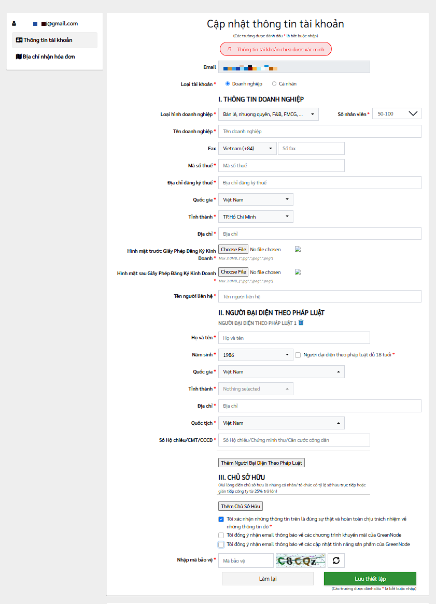
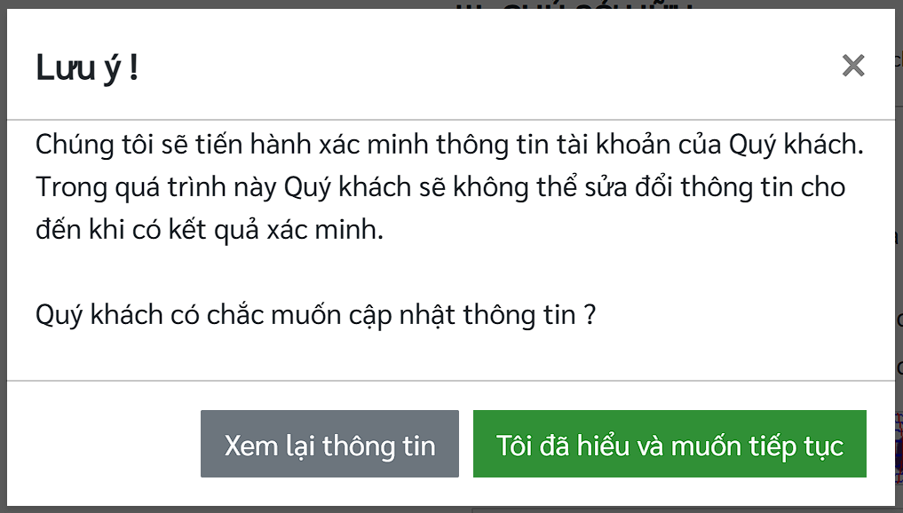

# Cập nhật thông tin tài khoản

**Bước 1:** Truy cập https://register.greennode.ai/profile hoặc chọn chức năng “**Cập nhật thông tin tài khoản**” trên menu:

<figure><figcaption></figcaption></figure>

**Bước 2:** Cập nhật thông tin tài khoản

<figure><figcaption></figcaption></figure>

* Những ô có dấu **\*** bắt buộc phải nhập
* Nhấn "Lưu thiết lập" để kết thúc quá trình cập nhật thông tin

**Bước 3:** Xác minh thông tin tài khoản. Hệ thống sẽ hiển thị Lưu ý về việc sẽ tiến hành xác minh thông tin tài khoản. Trong quá trình xác minh, Quý khách chỉ có thể xem lại thông tin đã nhập chứ không thể sửa đổi.

<figure><figcaption></figcaption></figure>

***
