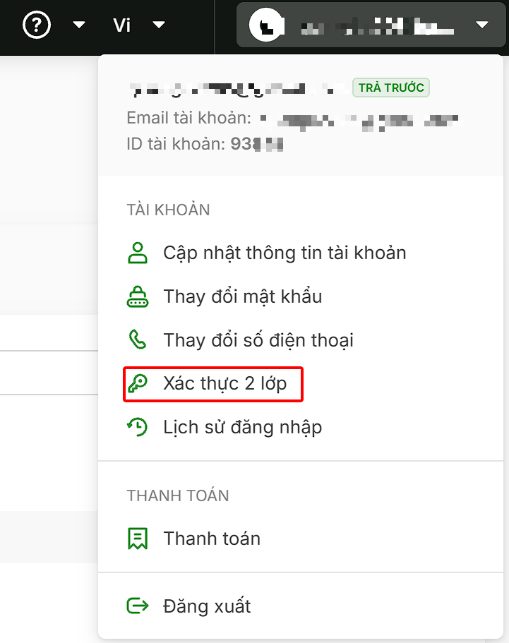
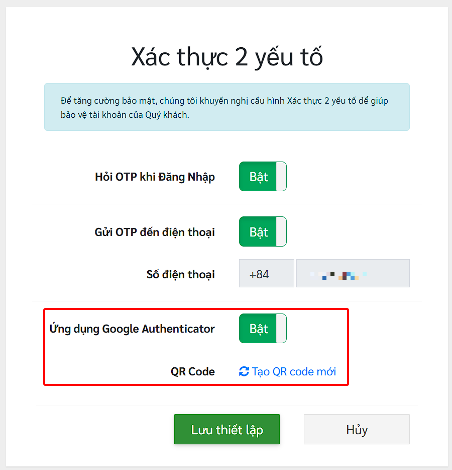
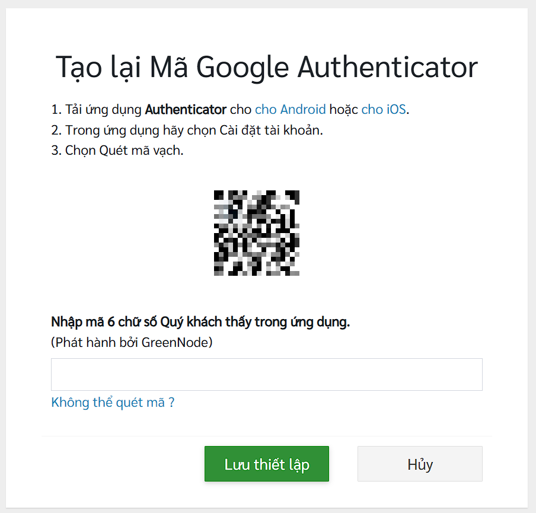

# Thiết lập xác thực 2 yếu tố (2FA)

**Xác thực 2 yếu tố** (2FA) bổ sung một lớp bảo mật cho tài khoản GreenNode. Khi được bật, ngoài mật khẩu, bạn cần nhập thêm **mã OTP** (mã dùng một lần) mỗi khi đăng nhập. Nhờ vậy, kể cả khi lộ mật khẩu, người khác cũng không thể đăng nhập vào tài khoản của bạn.

GreenNode hỗ trợ hai cách nhận mã OTP:

* **Gửi OTP đến điện thoại** — mã được gửi tới số điện thoại đã đăng ký của tài khoản (chỉ hỗ trợ số điện thoại có mã quốc gia Việt Nam +84).
* **Ứng dụng Google Authenticator** — mã được tạo trên ứng dụng Google Authenticator cài trên điện thoại của bạn.

Truy cập https://register.greennode.ai/change2fa?hl=vi hoặc chọn chức năng **"Xác thực 2 lớp"** trên menu tài khoản.

<figure><figcaption></figcaption></figure>

Các thiết lập trên trang:

| Thiết lập                         | Mô tả                                                                                                                           |
| --------------------------------- | ------------------------------------------------------------------------------------------------------------------------------- |
| **Hỏi OTP khi Đăng Nhập**         | Công tắc chính. Khi **Bật**, hệ thống yêu cầu nhập mã OTP mỗi lần đăng nhập. Khi **Tắt**, các tuỳ chọn bên dưới bị vô hiệu hoá. |
| **Gửi OTP đến điện thoại**        | Nhận mã OTP qua số điện thoại của tài khoản. Phương thức này chỉ hỗ trợ số điện thoại có mã quốc gia Việt Nam +84               |
| **Số điện thoại**                 | Số điện thoại nhận OTP (chỉ hiển thị, không sửa tại đây). Nếu cần thay đổi thì sử dụng chức năng Đổi số điện thoại.             |
| **Ứng dụng Google Authenticator** | Nhận mã OTP từ ứng dụng Google Authenticator.                                                                                   |
| **QR Code** — **Tạo QR code mới** | Tạo mã QR để liên kết tài khoản GreenNode với ứng dụng Google Authenticator.                                                    |
| **Lưu thiết lập**                 | Lưu các thay đổi.                                                                                                               |
| **Hủy**                           | Bỏ qua các thay đổi chưa lưu.                                                                                                   |

1.  **Nhận OTP qua sms**

    Nếu số điện thoại của bạn có mã quốc gia là Việt Nam (+84) thì tùy chọn "Gửi OTP đến điện thoại" sẽ sáng lên để bạn có thể bật/tắt tính năng này.

2. **Nhận OTP qua ứng dụng Google Authenticator.**

<figure><figcaption></figcaption></figure>

* Nhấn vào button **Tạo QR code**, bạn sẽ được đưa đến trang Tạo mã Google Authenticator và thực hiện theo các bước hướng dẫn
* Nhấn vào **Lưu thiết lập** để hoàn tất.

<figure><figcaption></figcaption></figure>

Hệ thống sẽ gửi email thông báo các thiết lập xác thực 2 yếu tố đã áp dụng.

Sau khi hoàn tất quá trình đăng ký xác thực 2 yếu tố, ở bước đăng nhập, tuỳ lựa chọn của khách hàng ở trên sẽ có các hình thức xác thực khác nhau.

* Đối với nhận OTP qua SMS, ngay sau khi bạn nhập đúng username và password, hệ thống sẽ tự động gửi một OTP đến số điện thoại của bạn, chỉ cần nhập mã nhận được để tiếp tục Đăng Nhập.
* Đối với đăng nhập thông qua Google Authenticator. Bạn vui lòng mở ứng dụng Google Authenticator trong máy và sao chép 6 số PIN hiển thị trong ứng dụng và nhập vào form yêu cầu của chúng tôi.
